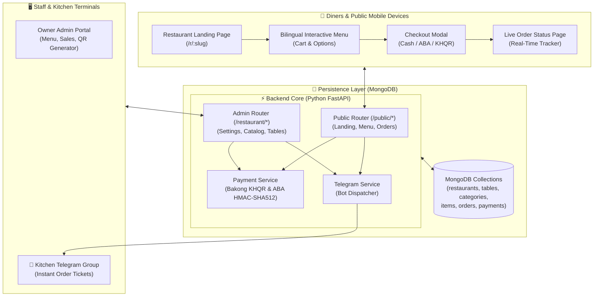
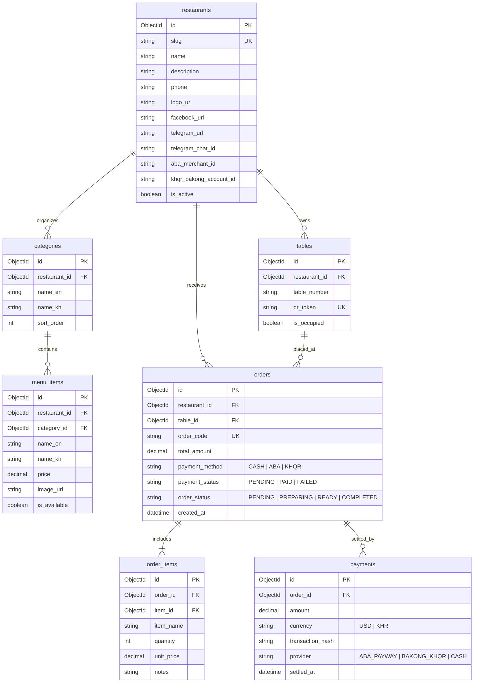
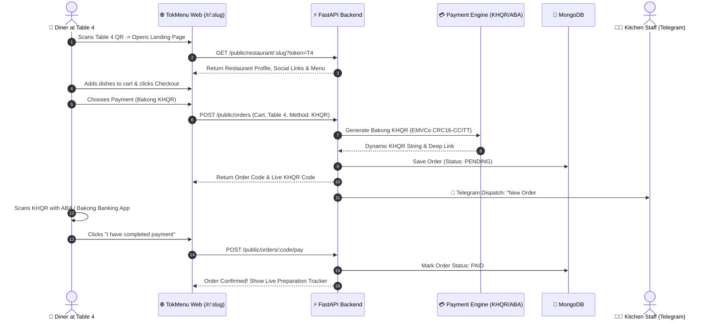

# 🍽️ TokMenu — Bilingual QR Restaurant Management, Table Ordering & Digital Payment Platform

<div align="center">


**A high-performance contactless dining and restaurant management suite built for Cambodian restaurants, cafés, and bars. Merges branded restaurant landing pages, table-specific digital menus, Bakong KHQR & ABA PayWay checkout, and real-time Telegram kitchen alerts.**

[System Architecture](#-system-architecture) • [Database ERD](#-database-erd) • [Order & Payment Sequence](#-order--payment-lifecycle) • [Quick Start](#-quick-start)

</div>

---

## ⚡ Overview

**TokMenu** solves dining friction for Cambodian hospitality venues. Diners simply scan a physical table QR code to open a beautiful restaurant landing page (`/r/:slug`) with social links, instant contact buttons, and a rich bilingual (Khmer/English) food menu. Diners customize dishes, choose Cash, Bakong KHQR, or ABA PayWay, and kitchen staff receive instant real-time Telegram order tickets.

---

## 🏗️ System Architecture



---

## 📊 Database ERD



---

## 🔄 Order & Payment Lifecycle



---

## 🚀 Quick Start

### 1. Backend Setup (FastAPI)
```bash
cd backend
python -m venv venv
venv\Scripts\activate
pip install -r requirements.txt

# Start Server (Port 8000)
uvicorn main:app --reload --port 8000
```

### 2. Frontend Setup (React with pnpm)
```bash
cd ../frontend
pnpm install
pnpm start
```

Visit `http://localhost:3000` to launch the ordering terminal.

---

## 📄 License
MIT License © **[Ros Rendo](https://github.com/RosRendo)**
